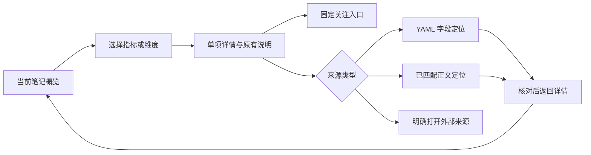

# 产品与交互方案

## 1. 主路径与信息层次

**先用视觉结构找到关注点，再用单项详情解释，最后回到原文核对。** 默认右侧面板约 360～420px，沿用 Obsidian 主题；320px 时布局单列。首版是单篇阅读工具，不做全库仪表盘。

| 层次 | 回答的问题 | 默认内容 | 密度预算 |
| --- | --- | --- | --- |
| 概览 | 讲什么、先看哪项？ | 摘要、三个主指标、维度入口 | 摘要最多 3 行，指标 3 行，不铺长理由 |
| 聚焦 | 这一项是什么意思？ | 当前指标/风险/对象的值、说明、依据 | 同时只有一个详情主体 |
| 定位 | 这段记录在哪里？ | 字段原文、已匹配正文或外部来源 | 入口明确区分，不伪造正文证据 |
| 扩展 | 还涉及哪些内容？ | 影响分组、对象目录、关系列表/图 | 主动进入再加载，列表分页 |

约 400×700px 可用面板是首屏设计基准，不是已验证适配结论。小高度允许滚动，不通过极小字号硬塞首屏。全量字段在维度详情可达，不要求同屏可见。

## 2. 首屏线框：真实样本、未配置量程

以下是布局规范示意，非运行截图；中文显示名是界面标签，摘要预览不改写原字段。

```text
┌ 知镜                        [固定笔记] [⋯] ┐
│ Omarchy                      [来源详情]    │
│ [概览]         [维度]         [关联]       │
│                                          │
│ 内容概览                     来自 tldr    │
│ DHH 在 Product Hunt 提交了一款名为         │
│ Omarchy 的 Linux 桌面系统，定位为……         │
│ [展开摘要]                                │
│                                          │
│ 影响力       2.5         置信度：高      ›  │
│ 复利价值     4.0         置信度：中      ›  │
│ 炒作程度     中          置信度：高      ›  │
│ 数值量程未配置                            │
│                                          │
│ 选择关注维度                              │
│ ┌ 风险：4 类 + 1 补充 ┐ ┌ 机会：3 条    ┐ │
│ └────────────────────┘ └───────────────┘ │
│ ┌ 对象：1 个主体      ┐ ┌ 影响：受益/承压┐ │
│ └────────────────────┘ └───────────────┘ │
│ [内容结构]  [其他判断]                    │
└──────────────────────────────────────────┘
```

三行指标使用数值、留白与选中边框构成比较入口，不用相对条长暗示分数可比。样本无法支持比例图，仍可以通过分类格、逻辑步骤、影响分组和对象结构实现可视化。配置量程后，单项可显示带 min/max 标签的点位刻度；不同指标独立解释，不画综合雷达。

风险/机会数量来自实际条目，表示内容规模，不表示强弱、优先级或独立证据数量。“对象 1 个主体”只计匹配后的 object_mentions/object_insights 对象；entities 的 4 个技术和 1 个人物另列于对象详情，不能混计。

## 3. 各维度用什么视觉形式

| 维度 | 可视形式 | 选择后出现 | 不能表达的含义 |
| --- | --- | --- | --- |
| 影响力、复利价值 | 独立数值行；配置后点位刻度 | 原值、对应置信度、reason | 无量程时不表示完成率，不跨维度排名 |
| 炒作程度 | 分类标签；枚举字典齐备后可用离散等级点 | level、reason、对应置信度 | 不是连续百分比 |
| 风险 | 四个等面积分类格 + 补充入口 | 对应 risk_matrix 文本 | 不用红黄绿暗示严重度，不画概率×影响图 |
| 机会 | 编号轨道/紧凑条目，保持原序 | 某条机会全文与字段定位 | 不推断收益或按价值排序 |
| 影响 | “受益判断/承压判断”两组等权条目；创新/商业模式入口 | 被选条目的原值/原有分析 | 两组不逐对连线，不能伪装因果网络 |
| 对象 | 主体卡 + 技术/人物分组 + 信号目录 | 定位、信号、受众、差异、对象风险与依据 | 名称出现不等于已存在笔记，不把 5.0 与文章分混比 |
| 内容结构 | key_logic_flow 有序步骤，当前步骤高亮 | 该步骤原文；上一/下一步 | 顺序不等于因果，五步不代表进度 |
| 其他判断 | sentiment、开发者关注点、信息熵等紧凑分组 | 原值与说明 | 未定义信息熵不叫信息质量，不做数值轴 |
| 关联 | 分组列表为基础；可选一跳图 | 关系理由与上下文预览 | 候选关系不当实际引用 |

窄面板风险格可用 2×2 分类布局，但每格必须写类别名；标题写“风险分类”，不写“风险矩阵”。对象、机会、影响只在各自视图呈现，不把这张表的所有组件同时铺开。

## 4. 聚焦详情与“锁定关键内容”

选择“复利价值”后的详情替换概览主体，顶部保留笔记名与返回入口。

```text
┌ Omarchy                   [返回概览] ┐
│ 复利价值                    [固定关注]│
│ 4.0               量程未配置         │
│ 置信度：中        来自笔记字段         │
│                                      │
│ 评分理由                              │
│ 投资逻辑链：(1) 商业天花板：Linux 桌面… │
│ 原文预览（最多 6 行）      [展开全文]  │
│                                      │
│ 依据与来源                            │
│ 来自 compound_value.reason            │
│ [定位字段]       [外部来源]            │
│ 字段生成方式未知                      │
└──────────────────────────────────────┘
```

长文预览从原文开头截取，以省略号和“原文预览”说明；不把自动截出的句子包装成摘要。P0 不自动压缩理由。定位按钮始终可见，不要求展开长文后才能找到。字段路径放在依据区，不占概览。

| 操作 | 结果 | 恢复与边界 |
| --- | --- | --- |
| 点指标/分类格/条目 | 选择一项并打开单项详情 | 返回保留原视图滚动与焦点 |
| 悬停或键盘聚焦图形 | 展示短提示/选中轮廓 | 不打开文件，不替换已选择详情 |
| 固定关注 | 在面板顶部保留一个紧凑返回条，记住“笔记 + 维度 + 条目” | 不复制全文，不写入 YAML；可替换或解除 |
| 在同篇中选择其他项 | 切换唯一详情，固定关注条仍可一键返回 | 不叠加第二个详情抽屉 |
| 固定笔记 | 面板不跟随主编辑区切换 | 与固定关注分开，顶部明确目标笔记 |
| 已固定关注时切到另一篇 | 面板照常跟随；关注条显示原笔记名 | 点关注条明确回到原笔记；不自动改当前详情 |
| 原字段/对象被删除 | 关注条提示“内容已变化”，停用旧位置跳转 | 可返回对应笔记，重新选择；不找邻近条目顶替 |

固定关注首版仅一项、仅保留当前会话；显示偏好（常看指标、次序、隐藏）可持久化。这样用户能短期锁定一段内容，又不会产生另一个收藏管理系统。固定笔记不冻结数据，编辑仍刷新当前版本；固定关注记录位置需随版本校验。

## 5. 完整任务路径



文本等价：概览 → 选择关注点 → 单项详情 → 固定关注或选择来源 → 定位字段/正文，或打开外部链接 → 返回原详情。外部页面不承诺回到固定滚动位置。

**看复利理由**：点“复利价值 4.0” → 原 reason 预览与中置信度 → 点“定位字段”。两次操作能发起原文定位；如 Obsidian 当前阅读模式需用户选择编辑视图，额外步骤单独记录。

**找技术风险**：点“风险” → 选四类中的“技术” → 读该项原文 → 固定关注。其他三类保持紧凑入口，详情不同时展开。

**看对象为何值得关注**：点“对象” → Omarchy → watch_reason 或产品信号 → 定位字段。对象 5.0 只在对象详情，旁边写定义/量程未声明；mention 的 high 不附到此分数上。

## 6. 来源、定位和摘要规则

完整摘要优先级见 [04](./04-sample-and-metric-catalog.md)。概览只显示一个已有摘要；其余摘要折叠在内容详情。已有字段标来源，不一概称人工。AI 后续生成时单独标记，不能覆盖人工或其他已有摘要。

“定位字段”与“定位正文”必须是不同操作：样本中文 evidence_snippets 只能可靠定位 YAML；没有匹配到英文正文时不显示正文定位。外部 source 仅是记录的网址，不自动证明所有 reason。定位过期时提示重新解析，失败仍可打开笔记；不能跳到旧行号。

来源详情展示原标签和必要差异：published 为 09-03，正文 Feed 日期为 09-04；author 为 Zac Zuo，正文提交者为 DHH。不自动选边、不把两者合并成一个作者或日期。第一阶段不专门建立日期/人名抽取器，可由原文入口核对正文值。

## 7. 关联列表与局部图

已有关系来自可解析的内部链接、反链及明确配置的关系字段；“可能相关”来自有解释的同标签/同实体候选。前置知识等语义仅来自显式配置，普通链接不能推断。

- 已有关系按显式字段、出链、反链分组；同文档合并卡片，保留所有关系原因。
- 标签候选排除当前文档、已有关系和 clippings 等配置的收集标签；最多 5 条，按共同有效标签数排序，同分按标题及路径。
- 同实体推荐属于后续 P1 能力，仅在身份可靠、跨笔记索引可用时启用；同名不直接认定同实体。
- 局部图主动展开后渲染，一跳最多 12 个邻居；显示“已展示 n / 总数 m”和完整列表入口。
- 实际引用用有方向实线，候选用无方向虚线及文字图例；键盘列表始终可独立操作。
- 选节点只预览；明确点“打开笔记”才导航。同名补路径，缺目标写“尚未创建”，不默认创建。
- 当前样本仅有 author 内链候选；目标文件是否存在须在真实 Vault 中解析。对象 article_ids 指回当前文章，不画自环，不虚构技术节点对应的笔记。

## 8. 配置、异常与可访问性

首次打开无需配置就能展示摘要与原值。高级设置再提供字段映射、显示名、排序、数值口径、枚举字典、显式关系字段、排除目录及收集标签。状态排除始终先于普通映射回退。

| 情况 | 用户看到什么 |
| --- | --- |
| 空文档 | 当前文件名、“这篇笔记还没有内容”，无上篇指标 |
| 无 YAML | 已有正文摘要/标题概览和可用链接 |
| 部分 null/空数组 | 不画空卡；对应详情可展开“未提供”项 |
| 字段类型异常 | 该项显示原值或无法解析；其他维度可用 |
| YAML 正在编辑或解析错误 | 提示更新/无法解析，不混用旧理由与新分 |
| 无关联 | 明确“未找到已有关系”，不拿推荐填作事实 |
| AI 失败/过期 | 其他功能可用；缓存标明过期，用户手动更新 |

颜色只表示选择/焦点和中性分组，不凭色彩传达风险强弱。图形配文本标签，Tab 可达、Enter/Space 选择、Esc 返回详情上层并恢复焦点；悬停信息有键盘等价入口。避免自动动画、动态图谱漂移；主题对比度、200% 缩放、320px 宽度需在真实环境验收。
